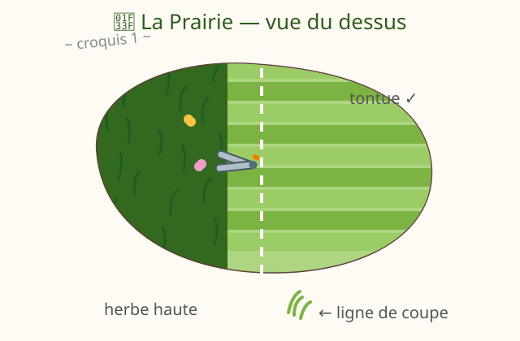
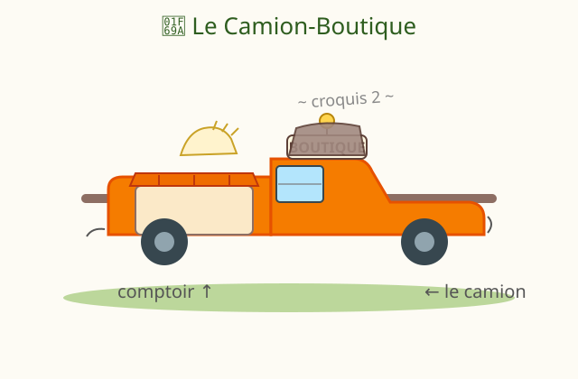
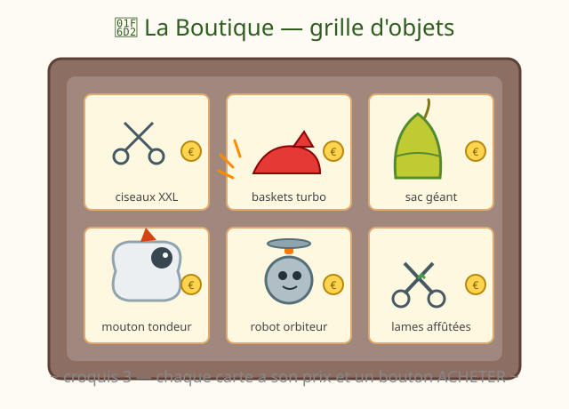
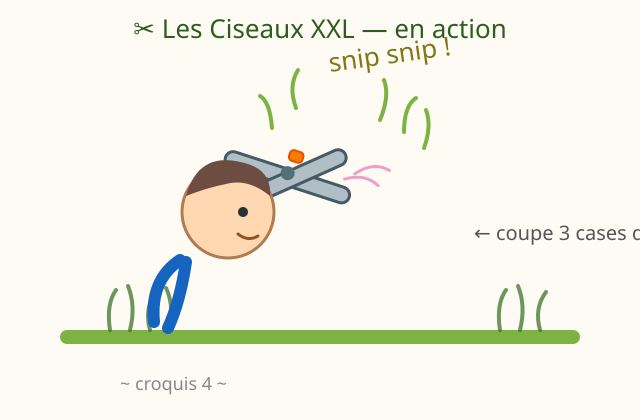
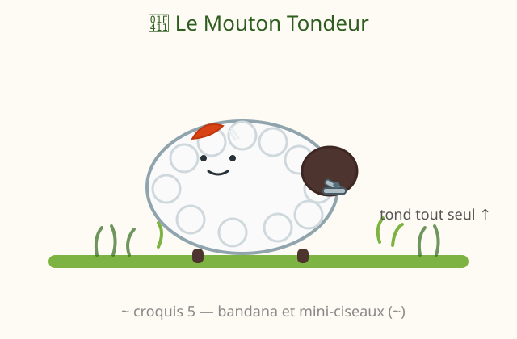
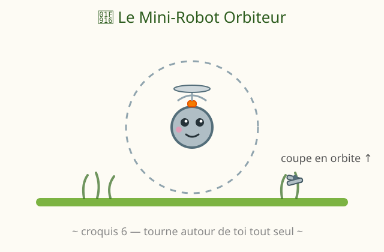
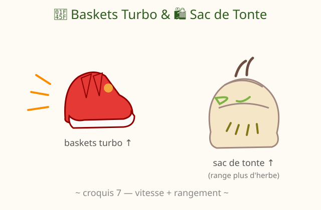
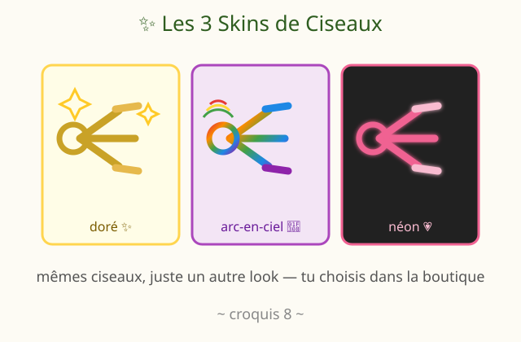
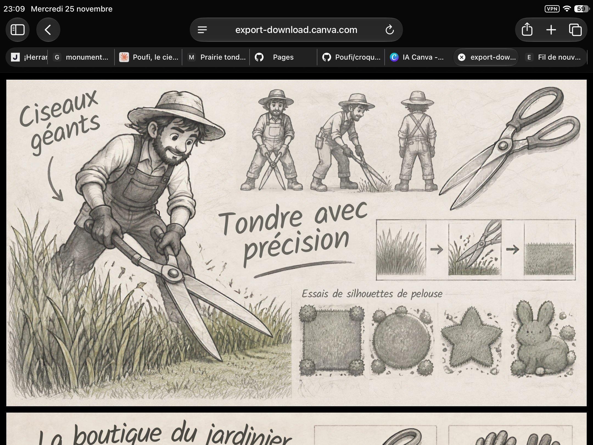
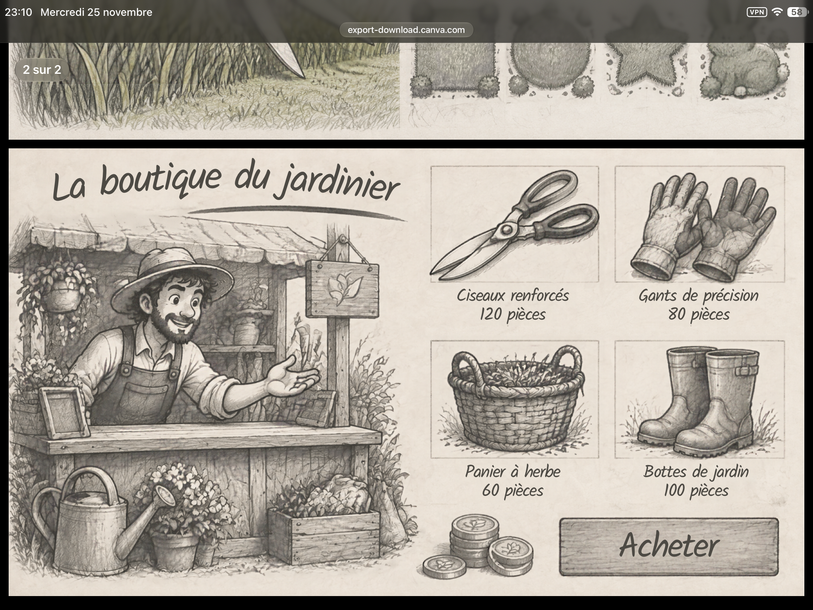

# 🌿 La Grande Tonte — Croquis de concept art

Premiers dessins du jeu **La Grande Tonte** : tonde toute une prairie… aux ciseaux ! ✂️

## 1. La Prairie (vue du dessus)

L'île d'herbe : à gauche l'herbe haute à tondre, à droite la pelouse déjà tondue avec ses bandes rayées. Les ciseaux coupent le long de la ligne blanche.

## 2. Le Camion-Boutique

Le camion orange garé au bord de l'île : comptoir ouvert sous l'auvent, panneau BOUTIQUE avec pièce d'or, ballot de foin et sacs d'herbe dans la benne.

## 3. La Boutique (grille d'objets)

L'écran boutique avec les 6 améliorations : ciseaux XXL, baskets turbo, sac géant, mouton tondeur, robot orbiteur, lames affûtées — chacune avec son prix.

## 4. Les Ciseaux XXL en action

Le personnage coupe l'herbe avec les ciseaux géants : brins qui volent et petit *snip snip* !

## 5. Le Mouton Tondeur 🐑

Le mouton acheté en boutique tonde tout seul, avec son bandana de jardinier et ses mini-ciseaux.

## 6. Le Mini-Robot Orbiteur 🤖

Le petit robot rond à hélice orbite autour du personnage (cercle en pointillés) et tond automatiquement au passage.

## 7. Baskets Turbo & Sac de Tonte

Les baskets pour courir plus vite (flammes et lignes de vitesse) et le grand sac pour stocker plus d'herbe d'un coup.

## 8. Les 3 Skins de Ciseaux

Les mêmes ciseaux, trois looks au choix en boutique : doré ✨, arc-en-ciel 🌈 et néon 💗.

## 9. Essais de silhouettes de pelouse (papier de référence)

Planche noir & blanc : les jardiniers aux cisailles géantes et les silhouettes de haies bonus (carré, rond, étoile, lapin…).

## 10. La boutique du jardinier (papier de référence)

Planche noir & blanc : le jardinier derrière son comptoir, avec les premiers prix — ciseaux renforcés (120), gants de précision (80), panier à herbe (60), bottes de jardin (100).

